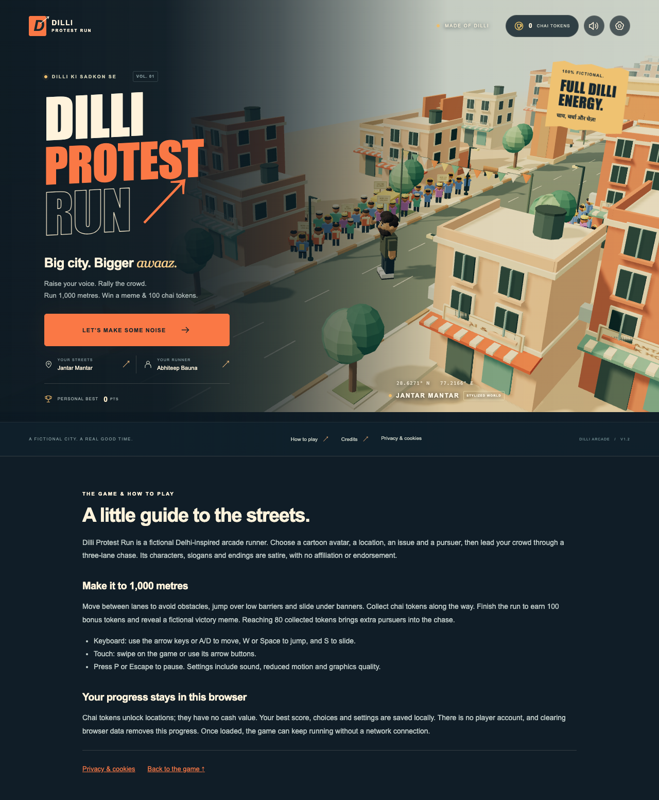
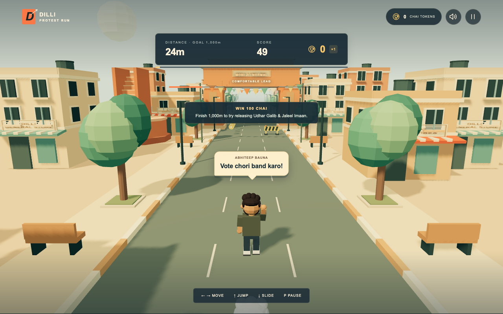
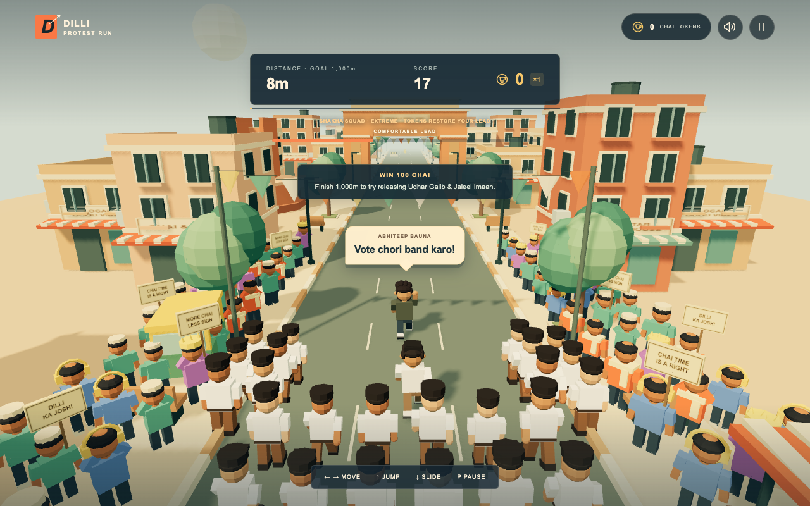
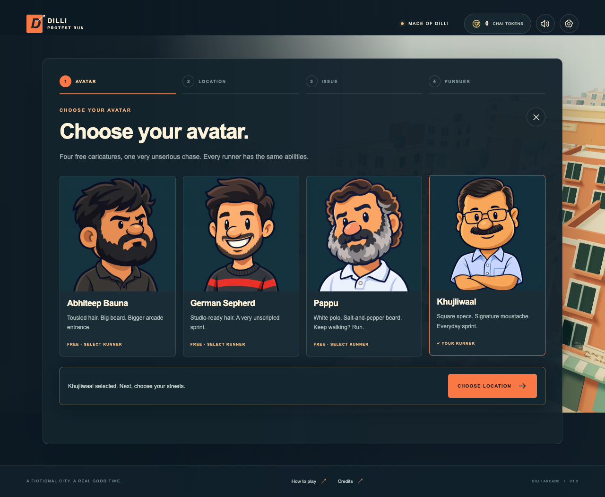

# Dilli Protest Run

An original, fictional Delhi-inspired 3D arcade runner built with TypeScript, Three.js, and Vite. Choose an avatar, location, issue, and pursuer, rally a cartoon crowd, then dodge your way through a stylized parody chase. No player accounts, backend, API keys, advertising, or paid assets are required.

The homepage also supports a shared **playing now** counter. It needs the small optional Node service described in [Live players setup](docs/LIVE_PLAYERS.md); core gameplay still works without it. The count covers visible, active runs and deduplicates tabs in one browser. It refreshes about every 15 seconds and expires disconnected sessions after 45 seconds. A service outage displays “live count unavailable”, never a made-up count. Static-only deployments can set `VITE_PRESENCE_ENABLED=false` before building.




## Play

Start with the four-step setup: **Avatar → Location → Issue → Pursuer**. Choose your runner, streets, campaign, and one of five pursuers, then select **Hit the streets**. Trigger your selected issue's slogan or skip the introduction. Your choices are saved for the next run.

Keep moving between three lanes, jump low obstacles, and slide beneath overhead banners. Your avatar periodically raises an arm and cycles through original speech bubbles matching the selected issue. Collect chai tokens to unlock locations. A collision increases pursuit pressure; too much pressure ends the run. At **80 chai collected during a run**, mixed RSS- and Bajrang-inspired reinforcements join and make the chase harder. Reach **1,000 metres** to win **100 bonus chai tokens** and a fictional release-voucher meme. The 80-token reinforcement trigger uses the current run's pickups, not your saved balance or the victory bonus. Pause to resume or return to the menu.

| Action         | Keyboard       | Touch                 |
| -------------- | -------------- | --------------------- |
| Left / right   | A / D or ← / → | Swipe left / right    |
| Jump           | W, ↑, or Space | Swipe up              |
| Slide          | S or ↓         | Swipe down            |
| Pause / resume | P or Escape    | Pause / resume button |

Menus work with pointer input and keyboard focus. Gameplay swipes start on the 3D canvas. Jump and slide do not repeat from a held key.

## Features

- Smooth lane changes, gravity-based jumping with a short landing buffer, and timed slides.
- A skippable slogan-and-crowd introduction with 60–118 spectators, scaled by graphics quality and location.
- Four separate setup screens, saved issue selection, and matching original running chants with speech bubbles and a raised-arm pose.
- Recycled street segments, pooled obstacles and collectibles, reproducible generation, and increasing difficulty across a 1,000-metre run.
- Jantar Mantar, India Gate, and Ramlila Maidan themes; four free public-figure caricature avatars.
- Five pursuers: Mobi ji (normal), Amit kaka (medium), Baba ji (hard), Bajrang Brigade and Shakha Squad (extreme).
- Extreme modes add 24/36/50 animated pursuers by quality, a wider chase camera, rising pursuit pressure, and token-based recovery.
- Mixed crowd reinforcements arrive once at 80 collected chai in any mode, increasing chase pressure and running speed.
- Distance score, collectible streaks, best score, location unlock purchases, and local progress saves.
- Sound and music controls, volume, reduced motion, vibration where supported, and graphics quality settings.
- Responsive layouts, visible focus, pause on loss of visibility, and a WebGL failure message.

All core gameplay assets are generated locally or bundled. An already loaded game can continue without network access. There is no service worker, so opening or reloading the site while offline is not guaranteed.

The [Privacy Policy](public/privacy.html), [Terms & Conditions](public/terms.html) and [FAQ](public/faq.html) use placeholder contact details and are included in the sitemap. Keep their descriptions aligned with actual hosting and data practices.

## Parody cast and crowd modes

The four playable runners are **Abhiteep Bauna**, **German Sepherd**, **Pappu**, and **Khujliwaal**. All four are free, and Abhiteep Bauna is selected by default. Their speed and collision abilities are identical. Udhar Galib and Jaleel Imaan appear only in the fictional victory reward. The former classic-avatar section and paid character unlocks have been removed from avatar selection; chai tokens still unlock locations.

The four playable avatar portraits are exaggerated 2D cartoons made with built-in `image_gen`: oversized heads, thick outlines, and simple illustrated faces. They are bundled as 640 × 640 WebP images, about 104 KiB together. The [current v3 prompts](docs/AVATAR_CARTOON_PROMPTS.json) restyle earlier generated portraits while discarding photographic detail and exact facial proportions. [Historical prompts and source URLs](docs/AVATAR_ART_PROMPTS.json) record the earlier reference work. Their animated gameplay models remain code-built 3D geometry; other portraits remain SVG artwork. Source photographs and superseded realistic portraits are excluded from the production build.

Bajrang Brigade and Shakha Squad use clothing cues from public Bajrang Dal and RSS photographs on generic original characters. These are fictional arcade encounters, with no affiliation, endorsement, or claim about real events. [Visual reference sources](docs/CHARACTER_REFERENCES.md) record all inspected photographs. No photographs are bundled or fetched at runtime.

In extreme modes, the crowd continually gains ground; each chai token reduces pressure. Baba ji and the extreme squads can catch you after two nearby stumbles, so keep a clear lane. At 80 collected chai, a mixed reinforcement crowd joins whichever pursuer you selected, the camera widens, and pursuit becomes harder. This happens once per run and resets on retry. Quality settings change crowd density, not difficulty. Earlier saves retain tokens, best scores, location unlocks, and valid selections. If a removed avatar was selected, the game switches to Abhiteep Bauna.





## Issues and running slogans

Choose **Vote chori**, **Gyaanu resign**, **Dharam resign**, **Exam fairness**, or **School sudhaaro** on the issue screen. The selected campaign determines the introduction slogan and the original lines that cycle above your runner during play. These are fictional arcade performances, with no recorded or impersonated voices.

The first three titles follow the user's requested campaign labels. The two additional themes draw on dated reporting checked on 14 October 2026. [Issue research and source distinctions](docs/ISSUE_REFERENCES.md) explain the references and uncertainty; the game is not a live news feed, and a selected slogan is not a factual finding about wrongdoing. Gyaanu and Dharam remain fictional aliases.

## Catch endings and the win reward

Each pursuer has a different result portrait and catch message. Mobi ji invites you for chai; Amit kaka and Baba ji have clearly fictional accusation and escape-to-Mars gags. Crowd modes have their own endings too.

At **1,000 metres**, the run stops and **100 bonus chai tokens** are added once, alongside the tokens you collected. Click **Release Udhar & Jaleel** to reveal the original behind-bars meme: **“Arcade CJI: bail not approved.”** This is an explicitly fictional joke, not a real court or release-status claim. Revealing or reopening the result does not award extra tokens; retry begins a fresh run.

## Local setup

Use **Node.js 22 LTS (22.13+) or Node.js 24+**; the project and CI use the Node 22 LTS line through `.nvmrc`. A recent browser with WebGL2 and hardware acceleration is required.

From the repository root:

```sh
# Optional, when using nvm:
nvm install
nvm use

npm ci
npm run dev
```

Open the local address printed by Vite, normally `http://127.0.0.1:5173`. Dependency installation requires internet access; gameplay does not require an external service.

| Command                | Purpose                                             |
| ---------------------- | --------------------------------------------------- |
| `npm run dev`          | Start the development server                        |
| `npm run typecheck`    | Check strict TypeScript types                       |
| `npm run lint`         | Run ESLint                                          |
| `npm run test`         | Run unit tests once                                 |
| `npm run test:watch`   | Run unit tests during development                   |
| `npm run test:e2e`     | Run Playwright browser tests                        |
| `npm run test:release` | Verify production/subpath/offline/graphics recovery |
| `npm run build`        | Typecheck and produce the static `dist/` bundle     |
| `npm run preview`      | Serve the production bundle locally                 |
| `npm run format`       | Format project files with Prettier                  |

## Testing and production preview

Install the test browser once, then run the checks:

```sh
npx playwright install chromium
npm run typecheck
npm run lint
npm run test
npm run build
npm run test:e2e
npm run test:release
```

By default the browser suite uses the installed Playwright Chromium. To use an existing Google Chrome installation for local troubleshooting, run `PLAYWRIGHT_CHANNEL=chrome npm run test:e2e`.

On Linux CI, install Chromium's system dependencies too:

```sh
npx playwright install --with-deps chromium
```

Playwright starts its own Vite test server on port 4174. Its configuration uses software WebGL for headless Chromium and one worker to avoid rendering resource contention. The deterministic browser harness requires **both** development mode and `VITE_E2E=true`; it is unavailable in production builds. Do not enable test configuration on a public development server.

`npm run test:release` checks the built bundle on a repository subpath, verifies that test-only cheats are absent, exercises offline play, and checks the WebGL fallback. Run `npm run build` first. It uses a separate preview server on port 4175 and also accepts `PLAYWRIGHT_CHANNEL=chrome`.

To inspect the release build, stop any server using port 4173 and run:

```sh
npm run build
npm run preview
```

Serve `dist/` over HTTP(S); opening `dist/index.html` directly as a `file:` URL is unsupported. Vite preview is for local verification, not a public production server. See [Vite's deployment guide](https://vite.dev/guide/static-deploy.html).

[DEVELOPMENT_STATUS.md](DEVELOPMENT_STATUS.md) records actual checks, milestone progress, and remaining validation. The GitHub Actions workflow runs installation, typechecking, linting, unit tests, a production build, and Chromium browser tests on pushes and pull requests. A failed required command fails the job; failure reports are uploaded when available. The browser setup follows [Playwright's CI guidance](https://playwright.dev/docs/ci).

## Deploy to AWS Lightsail

Follow [the Lightsail hosting guide](docs/LIGHTSAIL_HOSTING.md) to build locally, upload to a fresh Ubuntu instance, serve with Nginx, attach a static IP, configure HTTPS, and publish updates. It includes gzip and cache settings, current Mumbai transfer allowances, and capacity limits. No AWS deployment has been performed or verified.

## Search and link previews

Production builds include a descriptive title and summary, a canonical URL, Open Graph and Twitter card metadata, a 1200 × 630 game preview, `VideoGame` JSON-LD, `robots.txt`, and `sitemap.xml`. The game description, controls, browser requirements, and JavaScript-disabled message are present in the HTML before the 3D game starts, so they remain readable without JavaScript or WebGL.

The default public URL is the placeholder **https://example.com/**. Before publishing a deployment, replace `contact@example.com` in the HTML pages and configure your own operator details and site URL. To deploy elsewhere, set `VITE_SITE_URL` to the full homepage URL (including any subdirectory) before building. Set the matching asset base separately:

```sh
VITE_SITE_URL=https://example.com/ VITE_BASE_PATH=/ npm run build
```

Publish the entire `dist/` folder, including `social-preview.png`, `robots.txt`, and `sitemap.xml`. For a subdirectory deployment, publish `robots.txt` at the domain root or add its sitemap declaration to the existing root robots file. After deployment, verify those URLs return the expected files. These changes support crawling and sharing; indexing, rankings, and rich results are not guaranteed. See [Google's developer SEO guide](https://developers.google.com/search/docs/fundamentals/get-started-developers).

## Chrome graphics troubleshooting

The game requires **WebGL 2 in the player's browser**. The Lightsail server only serves files and does not need a GPU. In desktop Chrome, open `chrome://settings/system`, turn on **Use graphics acceleration when available**, and relaunch Chrome. If it still fails, update Chrome and the graphics driver, and inspect `chrome://gpu` or the browser console. On mobile, update the browser and open the site directly instead of through an in-app browser.

Startup lets the browser choose its GPU and retries on a fresh canvas without antialiasing when the first context fails. That fallback starts with Low quality. The `?graphics=low` link also starts without antialiasing and uses Low quality. Users can still change quality in Settings after launch. If WebGL 2 remains unavailable, the game shows browser-specific recovery steps; unrelated startup exceptions get a separate error message. A website cannot enable a browser's disabled graphics setting, and no WebGL 1 or 2D renderer is included.

## Deploy to Vercel

No public deployment has been verified. Connect your hosting account and deploy the repository using one of the following paths. Core gameplay requires no runtime secrets or environment variables.

**Dashboard:** push the repository to your Git provider, import it as a Vercel project, and use these settings:

| Setting          | Value                                         |
| ---------------- | --------------------------------------------- |
| Framework preset | Vite                                          |
| Root directory   | `.` — the directory containing `package.json` |
| Node.js version  | 22.x                                          |
| Install command  | `npm ci`                                      |
| Build command    | `npm run build`                               |
| Output directory | `dist`                                        |

Click **Deploy**, open the resulting URL, and verify the menu, introduction, gameplay, reload persistence, and mobile layout. These settings use Vercel's standard [Vite support](https://vercel.com/docs/frameworks/frontend/vite) and [build configuration](https://vercel.com/docs/builds/configure-a-build); no `vercel.json` override is necessary.

**CLI:** from the same repository root, authenticate and create a preview deployment:

```sh
npx vercel login
npx vercel
```

Choose the intended account/project and confirm the settings above. After reviewing the preview, publish production:

```sh
npx vercel --prod
```

Vercel prints the deployment URL. See the official [deployment command](https://vercel.com/docs/cli/deploy) documentation. Keep credentials and the local `.vercel/` project configuration out of source control.

For a custom domain, add it in the Vercel project's **Settings → Domains**, then apply the DNS records Vercel shows at your domain provider. Once verification completes, Vercel provisions HTTPS. Follow the current [custom domain instructions](https://vercel.com/docs/domains/working-with-domains/add-a-domain) and verify the final HTTPS URL.

## GitHub Pages alternative

For a project served at `https://OWNER.github.io/REPO/`, build with the repository subpath:

```sh
VITE_BASE_PATH=/REPO/ npm run build
```

For an account site or custom domain at the root, use `VITE_BASE_PATH=/`. The existing `vite.config.ts` reads this environment variable; no second Vite configuration is needed. See [Vite's base-path instructions](https://vite.dev/guide/static-deploy.html#github-pages).

In **Repository Settings → Pages → Build and deployment**, select **GitHub Actions**. To opt into deployment, save this separate manual workflow as `.github/workflows/pages.yml`, then run it from the default branch after CI passes:

```yaml
name: Deploy GitHub Pages
on:
  workflow_dispatch:
permissions:
  contents: read
  pages: write
  id-token: write
concurrency:
  group: pages
  cancel-in-progress: false
jobs:
  deploy:
    runs-on: ubuntu-latest
    environment:
      name: github-pages
      url: ${{ steps.deployment.outputs.page_url }}
    steps:
      - uses: actions/checkout@v7
      - uses: actions/setup-node@v7
        with:
          node-version-file: .nvmrc
          cache: npm
      - run: npm ci
      - run: npm run build
        env:
          VITE_BASE_PATH: /${{ github.event.repository.name }}/
      - uses: actions/configure-pages@v5
      - uses: actions/upload-pages-artifact@v4
        with:
          path: dist
      - uses: actions/deploy-pages@v4
        id: deployment
```

Change `VITE_BASE_PATH` to `/` for a root-domain deployment. The normal CI workflow does not publish a website. GitHub explains the required permissions, artifact upload, and deployment environment in its [custom Pages workflows guide](https://docs.github.com/en/pages/getting-started-with-github-pages/using-custom-workflows-with-github-pages).

## Code map

- `src/game/`: game loop, state orchestration, rendering, input, collision, pooling, audio, and test harness.
- `src/player/`: independently testable lane, jump, slide, and animation controllers.
- `src/protest/`: issue and slogan definitions, crowd-reaction sequence, pursuing crowds, and chase pressure.
- `src/economy/`: scoring, save validation, and unlock transactions.
- `src/characters/` and `src/locations/`: content definitions and procedural geometry.
- `src/assets/avatars/`: the four bundled AI-generated avatar portrait illustrations.
- `src/ui/` and `src/styles/`: accessible HTML controls and responsive presentation.
- `tests/unit/` and `tests/e2e/`: simulation tests and browser flows.

## Troubleshooting

| Problem                         | Action                                                                                                                          |
| ------------------------------- | ------------------------------------------------------------------------------------------------------------------------------- |
| Node or package engine error    | Switch to Node 22.13+ with `nvm use`, then run `npm ci`.                                                                        |
| Blank 3D scene / graphics error | Use a current browser, enable hardware acceleration, and check WebGL2 support.                                                  |
| Slow rendering                  | Choose Low graphics quality and reduced motion; close GPU-heavy tabs.                                                           |
| No audio                        | Click a game control first; browsers require a gesture. Check sound/music toggles and volume.                                   |
| Progress does not persist       | Check browser storage permissions or private-mode restrictions. Read the visible save warning; session progress remains usable. |
| Playwright browser missing      | Run `npx playwright install chromium`; use `--with-deps` on Linux.                                                              |
| Port 4174 is occupied           | Stop the existing test server before browser tests.                                                                             |
| GitHub Pages asset 404s         | Rebuild with the exact `/REPO/` base and upload the new `dist/`.                                                                |

Progress and avatar, location, issue, and pursuer selections are stored only in this browser's local storage under `dilli-protest-run.save`. The settings panel includes a confirmed reset action. Clearing site data also removes progress. Saves from a newer game version are protected from overwrite.

See [the measured performance notes](docs/PERFORMANCE.md) for resource limits, render-call reductions, and software-rendering measurements.

## Known limitations

- Music and effects are original synthesized placeholders; there are no recorded crowd voices.
- Local saves have no cloud sync, account recovery, or cross-device leaderboard.
- Automated mobile viewport checks do not establish real-device Android frame rates; physical-device performance and broader browser testing remain release checks.
- The current run is available offline after loading; cold offline launch is not supported.
- Public hosting, custom-domain setup, and execution on a remote GitHub Actions runner require account/repository setup and have not been verified locally.

## License and assets

The project is distributed under the [MIT License](LICENSE). Its artwork combines code-built 3D models, SVG portraits and signs, CSS, a favicon, and four AI-generated avatar illustrations; audio is synthesized. The four portrait illustrations were generated with `image_gen` from temporary photo references, with their prompts and provenance recorded in [AVATAR_ART_PROMPTS.json](docs/AVATAR_ART_PROMPTS.json) and [CHARACTER_REFERENCES.md](docs/CHARACTER_REFERENCES.md). Source photographs are not distributed with the game. The bundle includes no downloaded songs, protest recordings, paid models, or externally hosted fonts.

Three.js is distributed under its own MIT license. Its complete notice is preserved in [public/THIRD_PARTY_LICENSES.txt](public/THIRD_PARTY_LICENSES.txt) and copied into the production bundle. Development dependencies retain their respective licenses in their installed packages; consult `package-lock.json` for exact package versions. System fonts are supplied by the user's device and are not redistributed.
